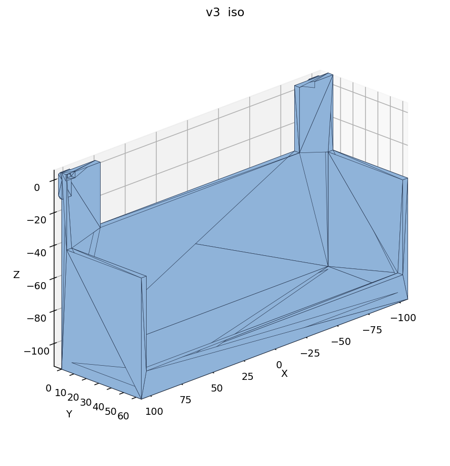

# 電視壁掛架掛勾喇叭籃

掛在**電視壁掛架後方沖孔角鋼立柱**上的藍芽喇叭置物籃，3D 列印件。
不用鑽孔、不用黏貼、不碰到電視——兩個掛鉤直接穿過角鋼原本的橢圓孔勾住。



## 這東西解決什麼

電視掛在牆上，喇叭沒地方放。壁掛架後方的沖孔角鋼立柱有現成的橢圓孔，
但角鋼面到電視背面只有 **8.6mm**，掛任何東西都得夠薄才不會頂到電視。

這個籃子的懸掛結構只有 **4.0mm 厚**，籃子本體整個落在電視下緣以下，
上方全開、前面開放讓喇叭朝前播放，前底留 12mm 淺擋板防止滑出。

## 適用尺寸（做之前先量你自己的）

| 項目 | 本設計的值 |
|------|-----------|
| 兩橢圓孔中心間距 | 200 mm |
| 橢圓孔 | 寬 8.3 × 高 19.8 mm（長軸垂直） |
| 角鋼面 ↔ 電視背面 | 8.6 mm |
| 喇叭 | 長 200 × 深 50 × 高 70 mm（HUAWEI 藍芽音箱含矽膠套） |

**尺寸不同也能用**——`cad/build_basket.py` 是參數化腳本，改開頭參數區重跑即可，
不必懂裡面的幾何。對照表見 [CONTEXT.md §9 調整旋鈕](CONTEXT.md#9-調整旋鈕改需求時只動-cadbuild_basketpy-參數區)。

## 成品規格

- 外形 214 × 70 × 120 mm，內腔 206 × 56 × 70 mm
- 壁厚 4.0 mm，單一封閉實體（Solids=1、isValid、isClosed）
- 100% 實心體積 172 823 mm³ ≈ 219 g PETG；實際切片約一半

## 直接列印

用 `cad/TV_Speaker_Basket_v3.stl`。

- **列印方向：籃底朝下直立**（＝懸掛姿態），不要旋轉
- **支撐必開**：兩個下折勾的底面是離平台 102mm 的懸空孤島，不支撐印不出來。
  用樹狀支撐；全模型真正需要支撐的只有 22.2 mm²
- 建議 PETG（韌性好，掛載件不易脆斷），0.2 層高，3 圈牆，12% gyroid，5mm brim

Bambu Studio A1 的完整參數與逐項理由見 [CONTEXT.md §8](CONTEXT.md#8-切片參數bambu-studio)。

## 改尺寸重新產生模型

需要 [FreeCAD](https://www.freecad.org/) 1.2+ 與 Python（numpy、matplotlib）。

```powershell
# 1) 改 cad\build_basket.py 開頭參數區（記得 VERSION +1）
# 2) 建模 → 產生 FCStd + STL + verify_<版本>.txt
& "C:\Program Files\FreeCAD 1.2\bin\FreeCADCmd.exe" ".\cad\build_basket.py"

# 3) 看驗證報表（FreeCADCmd 的 stdout 會亂碼，一律讀檔）
Get-Content cad\verify_v3.txt

# 4) 出 6 張正投影／立體驗證圖 + 朝下面（懸空）稽核清單
python cad\render_views.py v3
```

`build_basket.py` 開頭有 7 個 `assert` 擋住違規參數（舌片比孔寬、插入高度超過孔高、
背板厚超出電視餘隙等），改壞會直接報錯而不是印出裝不上的東西。

`render_views.py` 的懸空稽核會列出所有朝下的面並標記哪些真的需要支撐——
改幾何後跑一次，多出預期外的 `★需支撐` 就是改壞了。

## 檔案

| 路徑 | 用途 |
|------|------|
| `cad/build_basket.py` | 參數化 CSG 建模腳本（唯一真相來源） |
| `cad/render_views.py` | STL → 驗證圖 + 懸空稽核 |
| `cad/TV_Speaker_Basket_v3.stl` | 列印檔 |
| `cad/TV_Speaker_Basket.FCStd` | FreeCAD 工作檔 |
| `cad/verify_v3.txt` | 幾何驗證報表 |
| `CONTEXT.md` | 完整開發紀錄、設計理由、切片參數、踩過的雷 |
| `CLAUDE.md` / `AGENTS.md` | 給 AI agent 接手用的專案規範 |
